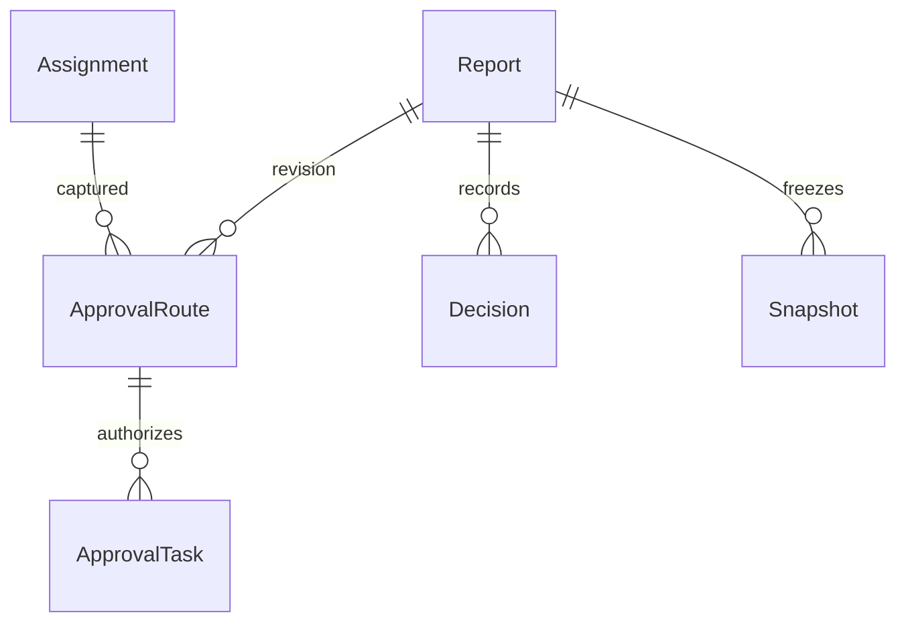

# Modelul aprobării / Approval data model

Schema release 10 extends the existing single-company report/identity/financial ledger. `Assignment` remains effective-dated. Submitted authority is represented by an immutable `ApprovalRoute` and a versioned `ApprovalTask`; live organisation changes do not rewrite either route evidence or historical decisions.

| Entity | Integrity / lifecycle |
|---|---|
| Assignment | Employee/manager IDs, department, active state and inclusive From/To. Admin-only mutation, overlap/cycle validation and audited import/provenance. |
| ApprovalRoute | Report/revision, assignment ID, manager/assignee/delegation snapshot, route-policy version, submitted-report hash, route hash, actor/time/reason. EF and database reject update/delete. |
| ApprovalTask | Report/revision/route/assignee authority is immutable. One Pending task per report through a filtered unique index. Decision or reassignment increments Version once; terminal outcomes cannot be overwritten. |
| Snapshot | Immutable report revision and financial/source lineage. Correction/resubmission and material reapproval create a new revision. |
| Decision | Immutable manager decision bound to a revision hash. Finance review/calculation/posting ledgers retain their separate immutable evidence. |
| Audit | Append-only before/after/reason plus actor/time, report correlation ID and available HTTP request ID. |

Financial corrections below the cumulative 50 RON threshold remain auditable Finance changes; they do not replace the manager's original submitted snapshot. Above the threshold, confirmation precedes a new review revision/task. FX-only changes remain exempt. Existing export batches and posting records retain their exact payload/hash and are never recalculated in place.

Approval mutations run inside the existing serializable, idempotent request transaction: compare report/task versions → verify current authority → decision/task transition → report transition → audit/notification outbox → commit. An exception rolls back the entire operation. Reassignment closes the prior Pending task before inserting the replacement, within the same transaction. Stale versions return conflict; no second decision is applied.

The migration adds tables/indexes and audit columns without deleting historical data. Old pending reports without a typed task require explicit Admin confirmation/reassignment. No historical manager decision is synthesized during migration. Restore uses the coordinated database/object backup and prior image described in the operating guide.
